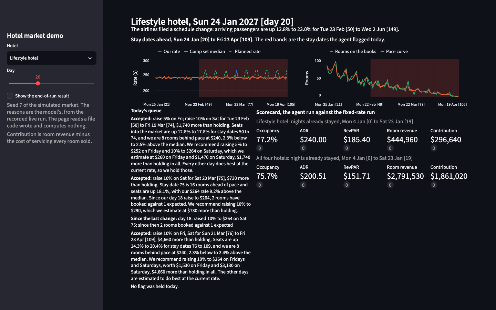
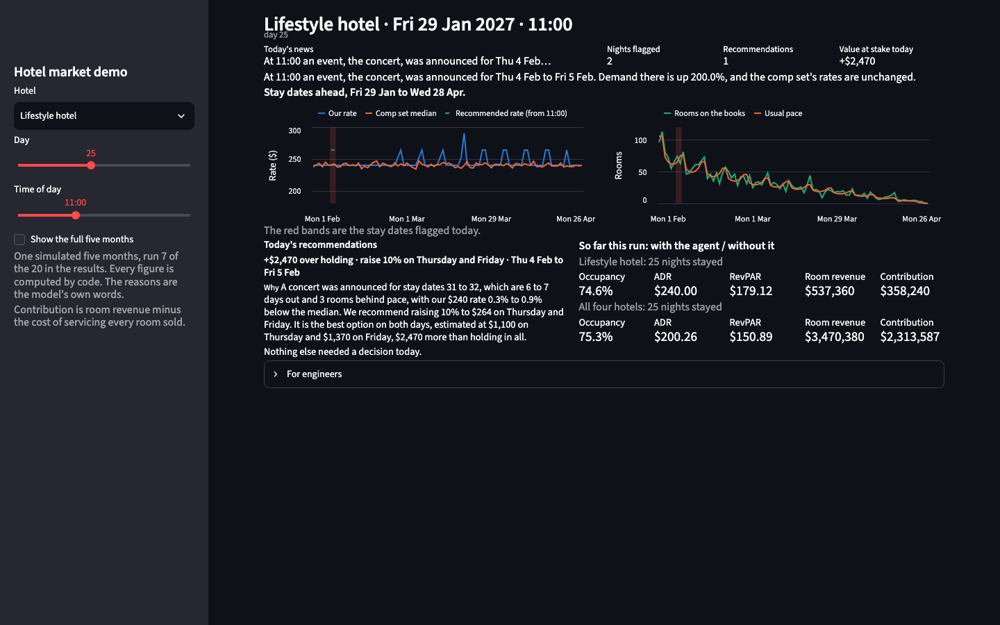

# Hotel market simulator

A made-up city with four hotels, and a pricing agent that reads the city's
feeds and recommends rate changes. Every number is synthetic. The agent runs
for 60 days; the bookings run for 150, so every night is finished and counted.

Four things happen while it runs: a convention is announced on day 10, new
flights are filed on day 20, a competitor cuts its rate on day 30, and an
airline suspends a route on day 40. The schedule rows follow Cirium's
published column names; every row is invented, and the repository has no
Cirium data and no affiliation with Cirium.

*Day 20 at the lifestyle hotel: the filing in the news line, three plans with
the model's recorded reasons, and the read-back of its day-18 raise.*

## Run it

    make setup          # .venv with the package, pytest and ruff
    make test           # the tests; make test-all adds the ten slow ones
    make demo SEED=7    # the demo page, with the model's recorded reasons

No API key is needed. `make demo` installs streamlit once. Every other
command is in [docs/commands.md](docs/commands.md).

## What the agent does each day

1. **Look.** For every hotel and stay date: are bookings ahead of or behind
   pace, did the comp median move, did arriving passengers change, was an
   event announced?
2. **Price.** On the dates where something changed, estimate what holding,
   raising 5%, raising 10% or lowering 5% would earn, on the rooms still
   unsold, with the chance of a sell-out counted.
3. **Ask.** Hand the best plan to the model: here are the numbers, agree or
   hold, and write a reason a revenue manager can read.
4. **Apply.** An accepted rate starts at the next tick, and those dates are
   left alone for seven days.

Code computes every number. The model only chooses between the plan and
holding, and its answer is checked against the options it was given. Without
a key, a stand-in answers in its place: it says yes to every plan and writes
a reason from the entry's own figures.

## The result

Twenty seeds, the agent against frozen rates, same booking luck in both runs.

| | |
| --- | ---: |
| Seeds where the agent earned more contribution | 20 of 20 |
| Mean contribution change per seed | +$16,164 |
| Smallest and largest | +$11,589 and +$23,394 |
| Mean room revenue change per seed | −$27,684 |
| Rate changes over the 20 seeds | 106 |

Room revenue falls and contribution rises: the agent raises on the nights
that will fill, sells slightly fewer rooms at a better rate, and saves the
cost of servicing the rooms it did not sell. RevPAR is flat or lower at every
hotel. Say that before a hotel person asks.

| Hotel | Occupancy, fixed / agent | Average rate | RevPAR |
| --- | ---: | ---: | ---: |
| Downtown convention hotel | 76.9% / 76.8% | $220.00 / $220.03 | $169.07 / $169.07 |
| Downtown full-service hotel | 76.5% / 76.5% | $190.00 / $190.06 | $145.37 / $145.36 |
| Lifestyle hotel | 77.0% / 76.1% | $240.00 / $242.50 | $184.76 / $184.44 |
| Airport hotel | 88.9% / 86.1% | $140.00 / $143.44 | $124.50 / $123.53 |

The forecast is the simulator's own formula, so this is a measurement of the
loop, not of a forecast. Scale the simulator's demand by 0.9 without telling
the agent and the gain falls to +$1,069 a seed, ahead in 12 seeds of 20.

Details: [the sweep](docs/results.md), [the revenue manager's
measures](docs/results.md#in-a-revenue-managers-measures), [the demand
bias](docs/results.md#the-demand-bias).

## Against a rule, not just against frozen rates

Frozen rates are an easy opponent. The fair one is a rule that raises 5% on
the same flags and never lowers, with no estimate and no model.

| | Per seed |
| --- | ---: |
| The never-cut rule against frozen rates | +$10,468 |
| The agent's lead over the rule | +$5,696, ahead in 18 of 20 |
| The lead over the same rule with 5% cuts | +$7,156 |

Every cut loses in this market, because with the cost at a third of the
rate and an elasticity of 1.5 the start rate is already the best rate on a
night that will not sell out. The gain lives in the nights the shocks make
scarce, and the new flights carry nearly all of it.

Details: [the rule-based control](docs/results.md#the-rule-based-control).

## What the model adds

In the default run, nothing to the number: every reviewer, the stand-in and
the three models, said yes to every plan, because the plans were right. The
model's judgment shows only when the plans are wrong, so the benchmark makes
them wrong on purpose by giving the agent the wrong elasticity, and scores
each model on which plans it declines against a perfect reviewer.

| Reviewer | Share of the perfect reviewer's margin recovered | Plans declined |
| --- | ---: | ---: |
| Opus, fixed wrong elasticity | 34% | 230 |
| Opus, learned elasticity | 10% | 41 |
| Sonnet | ties with saying yes | 8 and 3 |
| Haiku | ties with saying yes | 0 and 3 |

In those modes saying yes to everything earns −$6,265 and +$804 a seed; the
perfect reviewer earns +$13,107 and +$13,199. The benchmark's 7,744 calls
cost $85.87.

Details: [docs/reviewers.md](docs/reviewers.md).

## Data as it comes in

The loop runs on a clock, not in real time. With `--ticks 4` each day has
four moments: bookings land at every one, the rate shop at the second,
airline filings at the third, events at the fourth. The agent runs after
each, a rate applies from the next, and the next day's request carries what
happened on the dates it changed: "since then 2 rooms booked against 1
expected." The default is one tick a day, and that run is byte-identical to
before the clock existed.

On the demo market a finer clock earns nothing, because the news lands once
a day. On the same market with news inside the day it earns real money,
because a concert announced at ten in the morning sells rooms by noon.

| Market | Daily clock | Four ticks | Difference |
| --- | ---: | ---: | ---: |
| Demo | +$16,164 | +$16,204 | +$40, ahead in 10 of 20 |
| Demo with intraday news | +$19,640 | +$21,741 | +$2,101, ahead in 18 of 20 |

On the concert nights the daily loop sells 104 rooms at the old rate before
it can raise; the four-tick loop sells 30. The agent is the same code with
the same thresholds on both markets. The difference is the news.

Details: [the clock](docs/results.md#the-clock-one-tick-a-day-against-four),
[the clock with intraday news](docs/results.md#the-clock-on-the-world-with-intraday-news).

## What this is when a customer stands behind it

| In the repository | At a customer |
| --- | --- |
| The customer file | Their market: hotels, curves, comp sets, thresholds, calendar |
| The four interfaces | Reservations, rate shop, schedule feed, events calendar |
| The stored tables and `run-day` | The day's snapshot their systems write, and the daily job |
| The clock | The cadence of their feeds |
| The cache and `replay` | The audit trail: every request, every answer, every day rebuildable |

A second market runs from its file with one flag and no change to the agent:
`hotel-market --customer customers/harbour.toml --seed 7 --template`. Its
20-seed gain is +$4,815 a seed, ahead in 18 of 20.

## What the world taught me

**The neighbours trap.** When competitors follow the hotel's raises, the
never-cut rule beats the agent by $54,602 a seed, ahead in every seed. Each
raise moves the comp median, the moved median looks like news, and the news
allows another raise. Anyone who has watched a comp set shop itself will
recognise it. The simulator's market only gives back part of the gain, and
nothing here says how much a real one would.

**The convention didn't matter.** It is announced 35 days out, and a
convention hotel has most of those nights on the books by then. The plans
earn +$614 a seed on its stay dates, and +$100 if the competitors do not
raise with it. The money in a convention is in the group block and the
minimum stay; the agent only advises on the second and never touches the
first. The next version puts an event known before the run into the day-0
books.

**Faster only helps where the news is fast.** The clock table above. I built
it expecting a gain on the demo market and got none; the intraday market is
where it showed, and the reason is the feeds, not the agent.

Details: [the rule-based control](docs/results.md#the-rule-based-control),
[the convention](docs/results.md#the-convention-without-the-competitors-raise).

## How it was built

A PRD first, kept as it was: [docs/prd.md](docs/prd.md). Then CLAUDE.md as
the live spec, one module per prompt with its tests, and a knowledge graph
under [kg/](kg/) that a checker holds to the code. Three adversarial reads
before anyone else saw it.

## Read more

- [docs/results.md](docs/results.md): every experiment, one table each.
- [docs/reviewers.md](docs/reviewers.md): the model as a reviewer.
- [docs/limits.md](docs/limits.md): what this does not model, and the next version.
- [docs/commands.md](docs/commands.md): every command and make target.
- [docs/schedule-feed.md](docs/schedule-feed.md): the air schedule feed as modelled.
- [kg/README.md](kg/README.md): the knowledge graph's legend.